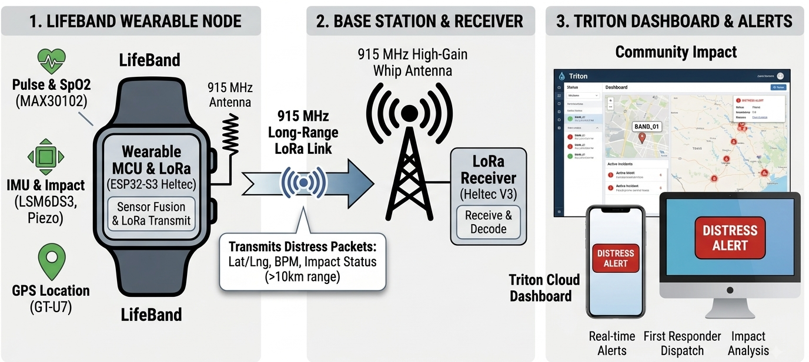
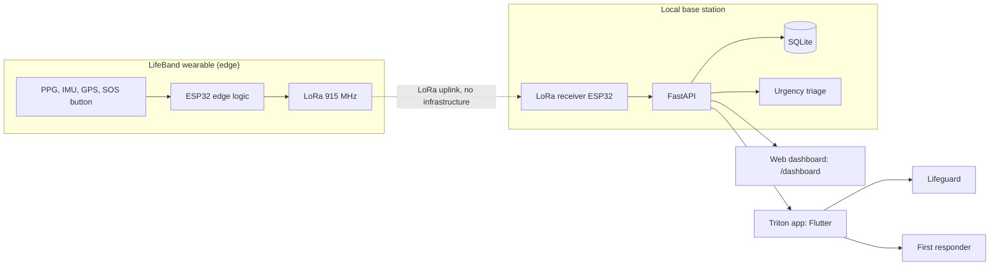

# LifeBand + Triton

**A wearable and app that alert rescuers automatically when someone is in distress in the water, with no Wi-Fi, cell service or cloud required.**

[](#)


*By Ananth Sridhar, Westwood High School, Austin, TX*

---

## Table of Contents
1. [Project Summary](#project-summary)
2. [Inspiration and Motivation](#inspiration-and-motivation)
3. [How It Works](#how-it-works)
4. [System Architecture](#system-architecture)
5. [Technical Stack](#technical-stack)
6. [Repository Structure](#repository-structure)
7. [Installation and Local Setup](#installation-and-local-setup)
8. [API Overview](#api-overview)
9. [Results](#results)
10. [Screenshots](#screenshots)
11. [Limitations and Future Work](#limitations-and-future-work)
12. [License](#license)

---

## Project Summary

LifeBand is a wrist-worn wearable that detects aquatic distress. It reads heart rate and motion on the device, decides on its own when someone is in trouble, and sends a tiny alert over **915 MHz LoRa** radio to a local base station. The base station runs **Triton**: a **FastAPI** server with a **SQLite** log, and a **Flutter** app that gives lifeguards and first responders a live, color-coded rescue list and map.

Three ideas make it work when other systems fail:

- **No Wi-Fi, no cell, no cloud.** The wearable talks to a local base station over its own radio, and the server and app run locally.
- **LoRa for bad conditions.** Sub-GHz radio is affected far less by rain, foliage and humid air than Wi-Fi or Bluetooth, and reaches about 1 km in field tests.
- **Edge computing.** The wearable raises the alert itself, so a victim who is exhausted or unconscious does not have to press a button. A manual SOS button remains as an override.

It is **one scalable solution for both flash floods and pools**: the same wearable, message format, server and app, with only the radio spreading factor and the app role (First Responder or Lifeguard) changing.

LifeBand is a complementary safety layer. It does not replace evacuation planning, flood sirens or trained staff.

## Inspiration and Motivation

On July 4, 2025, the Guadalupe River in Kerr County, Texas rose about 26 feet in 45 minutes. 138 people died along the river, including 27 campers and counselors at Camp Mystic. Kerr County had no flood warning system, and state investigators later reported that counselors' phones had been confiscated with no backup radios, and that hours of storm alerts went unacted on.

Kerr County sits in **Flash Flood Alley**, a corridor of steep terrain and intense rainfall running from the Dallas area through Austin and San Antonio. Texas leads the nation in flood deaths (1,069 from 1959 to 2019), and more than 80 Texans drown in pools each year. Many camps, rivers and pools have weak or no cell coverage, which is exactly when phone-based safety tools fail.

LifeBand asks one question: *can a small, low-cost device tell rescuers who is in trouble and where, even when every network is down?*

> The Flash Flood Alley region is described approximately in news and science reporting. It is not an official boundary.

## How It Works

1. **Sense.** The wearable samples a PPG heart-rate sensor, a 6-axis IMU and a GPS module 50 times a second.
2. **Decide on the edge.** If the wearer is nearly motionless while heart rate is extreme (above 150 or below 40 BPM), or the SOS button is pressed, the device builds an alert.
3. **Transmit.** A packed 14-byte binary payload (device ID, alert type, GPS, heart rate, SpO₂, battery) goes out over 915 MHz LoRa. The radio sleeps the rest of the time to save battery.
4. **Receive and log.** The base station receives the packet and posts it to the Triton backend, which stores every reading in SQLite.
5. **Triage and alert.** The backend computes an urgency score (0 to 100) from heart rate, water depth and rise rate, age vulnerability and battery. The app shows color-coded tiers, a live map, pool zones, and a siren and haptic alert for emergencies.

## System Architecture





## Technical Stack

| Layer | Technology | Role |
|---|---|---|
| Wearable MCU | ESP32 (Heltec V3 / ESP32-S3) | On-device sensor fusion and decision logic |
| Sensors | MAX30102 (heart rate, SpO₂), LSM6DS3 (6-axis IMU), GT-U7 (GPS), piezo element | Vitals, motion, location, water entry |
| Radio | LoRa 915 MHz (SX127x / SX126x) | Long-range, low-power, infrastructure-free link |
| Firmware | Arduino C++ (`lb_arduino/`) | 50 Hz sensing, distress rule, packed LoRa payload, sleep |
| Backend | Python, FastAPI, Uvicorn, SQLAlchemy, Pydantic | REST API, ingest, urgency triage, built-in web dashboard |
| Database | SQLite (default), PostgreSQL or MySQL via `DATABASE_URL` | Append-only telemetry log |
| Mobile app | Flutter / Dart (`triton_app_v2/`) | Role-based triage, victim detail, map, alerts |
| App packages | `http`, `flutter_map`, `latlong2`, `vibration`, `audioplayers`, `flutter_local_notifications` | Networking, maps, haptics, siren, notifications |
| Auth | `X-API-Key` header on write endpoints | Protects `POST /victims` and `POST /telemetry` |

## Repository Structure

```
LifeBand/
├── README.md
├── LICENSE
├── Run.sh                 # macOS helper: runs the Flutter app on every connected phone
├── lb_arduino/            # ESP32 firmware and LoRa range/latency test sketches
│   ├── LB_EdgeDistressLogic.ino/   # main wearable firmware (edge decision logic)
│   ├── SF_TX, SF_RX, PLR_*         # spreading-factor and packet-loss test sketches
│   └── libraries/                  # bundled Arduino libraries
├── triton_backend/        # FastAPI + SQLite server, triage logic, simulators
│   ├── main.py            # API routes and web dashboard
│   ├── triage.py          # urgency score
│   ├── pool_zones.py      # GPS to named pool zone
│   ├── auth.py            # API key check
│   ├── seed_data.py       # registers 50 test wearers
│   └── simulate_live_data.py
├── triton_app_v2/         # Flutter app (iOS, Android, desktop, web targets)
└── lb_docs/               # Paper, poster, slides and images
```

## Installation and Local Setup

You can run the whole software stack **without any hardware**, using the built-in simulator.

### Prerequisites

| Requirement | Version |
|---|---|
| Python | 3.10 or newer |
| Flutter SDK | Dart SDK ^3.12 (see `triton_app_v2/pubspec.yaml`) |
| Xcode or Android Studio | for running on a phone or emulator |
| Arduino IDE | only to flash hardware |
| Hardware (optional) | 2 x ESP32 LoRa boards, MAX30102, LSM6DS3, GPS module, 915 MHz antennas |

### 1. Clone

```bash
git clone https://github.com/ananth-sri/LifeBand.git
cd LifeBand
```

### 2. Start the backend

```bash
cd triton_backend
python3 -m venv venv
source venv/bin/activate          # Windows: venv\Scripts\activate
pip install -r requirements.txt
uvicorn main:app --reload --host 0.0.0.0 --port 8000
```

- `--host 0.0.0.0` lets your phone reach the server on your network.
- Open `http://localhost:8000/dashboard` for the web dashboard and `http://localhost:8000/docs` for interactive API docs.
- The SQLite database `triton.db` is created automatically.
- Optional: set your own write key with `export TRITON_API_KEY="something-long-and-random"`. The default dev key is `dev-key-change-me`, which is fine only on your own machine.
- Find your computer's IP (macOS): `ipconfig getifaddr en0`

### 3. Load test data (no hardware needed)

In a second terminal, with the backend running:

```bash
cd triton_backend
source venv/bin/activate
python3 seed_data.py              # registers 50 test wearers (LB001 to LB050)
python3 simulate_live_data.py     # streams live readings; Ctrl+C to stop
```

The simulator mimics the wearable's edge behavior: it only sends readings that are warning or critical.

Or send a single reading by hand:

```bash
curl -X POST http://localhost:8000/victims \
  -H "Content-Type: application/json" -H "X-API-Key: dev-key-change-me" \
  -d '{"name": "Test Swimmer", "device_id": "esp32-001", "age_years": 34}'

curl -X POST http://localhost:8000/telemetry \
  -H "Content-Type: application/json" -H "X-API-Key: dev-key-change-me" \
  -d '{"device_id": "esp32-001", "bpm": 168, "piezo_depth": 3834, "latitude": 30.2672, "longitude": -97.7431, "battery_pct": 43}'
```

### 4. Run the Triton app

1. Open `triton_app_v2/lib/main.dart` and set the backend address near the top of the file:

   ```dart
   const String kApiBaseUrl = 'http://<your-computer-ip>:8000';
   const String kApiKey = 'dev-key-change-me';   // must match TRITON_API_KEY
   ```

2. Install dependencies and run:

   ```bash
   cd triton_app_v2
   flutter pub get
   flutter devices
   flutter run -d <device-id>
   ```

   On macOS, `./Run.sh` opens one Terminal window per connected phone. It assumes the project is at `~/Developer/triton_app_v2`, so edit `PROJECT_DIR` in the script if yours is elsewhere.

3. Pick a role: **Lifeguard** (pool triage and zone lookup) or **First Responder** (flood tracking and map). The **Mock Data** toggle runs the app with built-in demo data and no backend.

Your phone and computer must be on the same network.

### 5. Flash the hardware (optional)

1. Install the Arduino IDE and the ESP32 board package for your board.
2. Install the libraries the main sketch includes: `LoRa`, `SparkFun LSM6DS3`, `SparkFun MAX3010x`, and `TinyGPSPlus`. Copies are bundled in `lb_arduino/libraries/`.
3. Open `lb_arduino/LB_EdgeDistressLogic.ino/` and check the pin definitions at the top of the sketch against your wiring. The frequency is set to 915 MHz.
4. Give each wearer a unique `node_id`, then upload to the wearable.
5. Upload one of the receiver sketches (for example `lb_arduino/SF_RX/`) to the base-station board. A bridge that forwards received packets to `POST /telemetry` is described in the paper's pipeline. See [Limitations](#limitations-and-future-work).

### Troubleshooting

| Problem | Fix |
|---|---|
| App shows no data | Check `kApiBaseUrl`, that phone and computer share a network, and that uvicorn runs with `--host 0.0.0.0` |
| `401 Invalid or missing X-API-Key` | The key in your request or app must match `TRITON_API_KEY` |
| Firewall blocks the phone | Allow incoming connections on port 8000 |
| `flutter devices` shows no phone | Pair or connect the phone and trust the computer |
| No LoRa packets | Check both boards use the same frequency, spreading factor and antennas attached before power-up |

## API Overview

| Method | Endpoint | Purpose |
|---|---|---|
| POST | `/victims` | Register a wearer (name, device ID, age). Needs `X-API-Key` |
| GET | `/victims` | List all wearers with latest reading and urgency |
| GET | `/victims/{id}` | One wearer with latest reading |
| POST | `/victims/{id}/acknowledge` | Mark a victim as being handled by a responder |
| POST | `/victims/{id}/unacknowledge` | Undo an acknowledgement |
| POST | `/telemetry` | Push a reading (`bpm`, `piezo_depth`, GPS, battery, `sos`, `plr`). Needs `X-API-Key` |
| GET | `/victims/{id}/telemetry` | Reading history for one wearer |
| GET | `/dashboard` | Built-in web dashboard (live map, urgency heatmap, dispatch queue) |

### Wearable payload (14 bytes, packed)

| Field | Bytes | Meaning |
|---|---|---|
| `node_id` | 1 | Device ID |
| `alert_flag` | 1 | `0` normal, `1` automatic distress, `2` manual SOS |
| `latitude`, `longitude` | 8 | GPS (two 4-byte floats) |
| `heart_rate` | 1 | BPM |
| `spo2` | 1 | Oxygen saturation % |
| `battery_mv` | 2 | Battery voltage in mV |

## Results

Measured and modeled results from the project paper (see `lb_docs/`):

| Metric | Result |
|---|---|
| LoRa range tested | 50 m to 1 km across open air, open water, tree canopy and urban areas |
| Packet loss at 50 m | 0.0% open air, 1.2% urban |
| Packet loss at 1 km | 6.6% open air, 12.0% open water, 20.5% tree canopy |
| Energy vs. cloud streaming | Over 60% lower, from on-device decisions (power model) |
| Estimated battery (1,000 mAh) | About 10 to 22 days normal monitoring; about 4.5 to 5.5 years deep sleep |
| Emergency broadcast battery | About 7 to 9 hours (flood, SF10 to 12); about 12 to 14 hours (pool, SF8) |

Range figures are field measurements. Battery figures are datasheet-based estimates, not measured runs. Rain itself was not tested.

## Screenshots

Add screenshots under `lb_docs/images/` and link them here, for example the role select, lifeguard triage and victim detail screens.

## Limitations and Future Work

- **Not clinically validated.** The distress rule and the urgency weights in `triton_backend/triage.py` are first-draft placeholders. They need review by EMS and clinical experts before any real-world use.
- **Firmware gaps.** SpO₂ and battery voltage are placeholder values in the current firmware, and the gateway that forwards received LoRa packets to `POST /telemetry` is not yet in this repository. The simulator and Mock Data mode demonstrate the full software path.
- **Range depends on environment.** Packet loss rises with distance and obstruction, so the app should always show signal quality and last-seen time.
- **Planned:** custom low-cost PCB with an IP68 waterproof enclosure, LoRa mesh relays, on-device machine learning trained on field data, alerts sent back to the wearer, pilots with Texas camps, pools and rescue teams, and worldwide adoption through an open-source, offline-first app with regional LoRa bands.

## License

Released under the MIT License. See [LICENSE](LICENSE).
