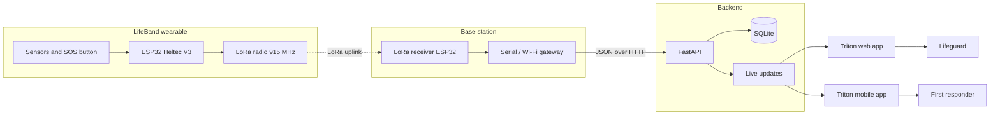

# LifeBand

**A long-range, low-power wearable that detects aquatic distress and alerts rescuers, with no cell towers or Wi-Fi required.**

[](#)

-B3271E)


*By Ananth Sridhar*

---

## Table of Contents
1. [Project Summary](#project-summary)
2. [Inspiration and Motivation](#inspiration-and-motivation)
3. [System Architecture](#system-architecture)
4. [Technical Stack](#technical-stack)
5. [Installation and Local Setup](#installation-and-local-setup)
6. [Message Format](#message-format)
7. [Screenshots](#screenshots)
8. [Repository Structure](#repository-structure)
9. [Limitations and Future Work](#limitations-and-future-work)
10. [Acknowledgments](#acknowledgments)

---

## Project Summary

LifeBand is an end-to-end distress-detection system for people in and near water. A wrist-worn device senses trouble (automatically, or when the wearer presses an SOS button) and sends a compact message over **LoRa** radio to a nearby base station. The base station forwards it to a **FastAPI** backend that stores it in **SQLite** and pushes it live to the **Triton** web and mobile apps, where lifeguards and first responders see who needs help and exactly where.

Key ideas:

- **Works without infrastructure.** LoRa at 915 MHz reaches far beyond Bluetooth or Wi-Fi and needs no cell coverage, which matters in river valleys, camps and remote shorelines.
- **Low power.** The device mostly sleeps and sends short packets, so one battery lasts long.
- **Automatic and manual triggers.** Distress can be detected by the device or raised by the wearer. Periodic heartbeats show the device is alive and in range.
- **Responder-first apps.** Role-based views (lifeguard, first responder) with a live map, a triage list and a detail view for each victim.

LifeBand is meant as a **complementary safety layer**, not a substitute for evacuation planning, supervision or official warning systems.

## Inspiration and Motivation

In July 2025, catastrophic flash flooding along the Guadalupe River in Kerr County, Texas killed more than 130 people, including 27 campers and counselors at Camp Mystic. The river rose about 26 feet in 45 minutes. Kerr County sits in **Flash Flood Alley**, where steep terrain and intense rainfall send water racing into creeks and rivers, and Texas leads the nation in flood deaths.

Many of the places people gather near water (camps, river corridors, remote pools and lakes) have weak or no cell coverage, so phone-based safety apps fail exactly when they are needed. LifeBand was built to answer one question: *can a small, cheap, battery-friendly device tell rescuers who is in trouble and where, even with no network at all?*

## System Architecture


The same flow as a diagram that GitHub renders natively:



**Data flow:** sensor event or SOS press, then device builds a JSON packet, then LoRa uplink, then base station, then FastAPI validates and stores it, then the web and mobile apps update in real time.

## Technical Stack

| Layer | Technology | Role |
|---|---|---|
| Wearable hardware | ESP32 Heltec WiFi LoRa 32 (V3) | Microcontroller, LoRa radio and OLED in one board |
| Radio | LoRa, 915 MHz ISM band | Long-range, low-power link between wearable and base station |
| Firmware | Arduino framework / C++ (`lb_arduino/`) | Sensing, trigger logic, packet building, sleep management |
| Base station | Second Heltec V3 plus a gateway computer | Receives LoRa packets and forwards them to the API |
| Backend | Python, FastAPI, Uvicorn (`triton_dashboard/`) | REST and live-update API, validation of incoming packets |
| Database | SQLite | Stores devices, alerts, heartbeats and telemetry |
| Web app | Triton web dashboard (`triton_dashboard/`) | Live map, tables and alert triage in a browser |
| Mobile app | Triton mobile app (responsive view of `triton_dashboard/`) | Role select, lifeguard triage, victim detail, responder map |
| Message format | JSON | One schema for auto alerts, manual SOS and heartbeats |

> Component datasheets, pinouts and wiring notes are in [`lb_hardware/`](lb_hardware/).

## Installation and Local Setup

### Prerequisites

| Requirement | Version |
|---|---|
| Python | 3.10 or newer |
| Arduino IDE (or PlatformIO) | latest |
| Hardware (optional) | 2 x Heltec WiFi LoRa 32 V3 boards with 915 MHz antennas (see `lb_hardware/`) |
| Git | any recent version |

You can run the dashboard **without hardware** by using the test alert in step 3.

### 1. Clone the repository

```bash
git clone https://github.com/<your-username>/lifeband.git
cd lifeband
```

### 2. Run the Triton dashboard (FastAPI + SQLite)

```bash
cd triton_dashboard
python -m venv .venv
source .venv/bin/activate          # Windows: .venv\Scripts\activate
pip install -r requirements.txt
uvicorn main:app --reload --port 8000
```

Open `http://localhost:8000` for the dashboard and `http://localhost:8000/docs` for the interactive API docs. The SQLite database is created automatically on first run.

### 3. Send a test alert without hardware

With the server running, post a sample packet:

```bash
curl -X POST http://localhost:8000/api/alerts \
  -H "Content-Type: application/json" \
  -d '{
    "device_id": "LB-001",
    "msg_type": "sos",
    "timestamp": "2026-07-04T10:15:00Z",
    "trigger": "manual",
    "location": {"lat": 30.0474, "lon": -99.1403},
    "telemetry": {"battery": 87},
    "radio": {"rssi": -92, "snr": 7.5},
    "status": "active"
  }'
```

The alert should appear on the dashboard map and tables within a second or two.

### 4. Flash the hardware (optional)

1. Wire the boards and antennas using the notes in `lb_hardware/`.
2. In Arduino IDE, add the **Heltec ESP32** board package and select **Heltec WiFi LoRa 32 (V3)**.
3. Install the Heltec LoRa library and any others listed in the sketch headers in `lb_arduino/`.
4. Set the frequency to **915 MHz** and give each wearable a unique device ID in the config section of the sketch.
5. Upload the wearable sketch to the wearable board and the receiver sketch to the base station board.
6. Point the base station at your dashboard's address (for example `http://<your-computer-ip>:8000`) so it can forward packets.

### 5. Use the app on a phone

With your phone on the same network, open `http://<your-computer-ip>:8000` in the browser and choose a role (lifeguard or first responder).

### Troubleshooting

| Problem | Fix |
|---|---|
| `uvicorn: command not found` | Activate the virtual environment, then reinstall requirements |
| Dashboard shows no alerts | Confirm the server is running and the test `curl` returns success |
| No packets from hardware | Confirm both boards use the same frequency, spreading factor and sync word, and that antennas are attached before powering on |
| Phone cannot reach the dashboard | Run uvicorn with `--host 0.0.0.0` and allow port 8000 through the firewall |
| Serial port permission denied (Linux) | `sudo usermod -aG dialout $USER`, then log out and back in |

## Message Format

Every device message is a small JSON object. The three types are an automatic alert, a manual SOS and a periodic heartbeat.

```json
{
  "device_id": "LB-001",
  "msg_type": "sos",
  "timestamp": "2026-07-04T10:15:00Z",
  "trigger": "manual",
  "location": { "lat": 30.0474, "lon": -99.1403 },
  "telemetry": { "battery": 87 },
  "radio": { "rssi": -92, "snr": 7.5 },
  "status": "active"
}
```

See the project paper in [`lb_docs/`](lb_docs/) for the full schema and the exact payload examples.

## Screenshots

| Web dashboard | Lifeguard triage | Victim detail |
|---|---|---|
|  |  |  |

### Range testing

| Test 1 | Test 2 | Test 3 |
|---|---|---|
|  |  |  |

## Repository Structure

```
lifeband/
├── README.md
├── lb_arduino/          # ESP32 firmware (wearable and base station)
├── lb_hardware/         # Component info: boards, sensors, battery, wiring
├── lb_docs/             # Research paper, slides and images
└── triton_dashboard/    # Triton web dashboard and app, FastAPI backend, SQLite
```

## Limitations and Future Work

- LoRa range depends on terrain, vegetation, antenna height and water. Field results are in the range-test charts above.
- Detection thresholds need broader testing across swimmers, ages and conditions to limit false alarms.
- Planned: waterproof enclosure and battery optimization, mesh relays to extend coverage, flood-level and rising-water sensing, and integration with local emergency services.

## Acknowledgments

- Built for the **Congressional App Challenge**.
- Flood background: reporting on the July 2025 Texas Hill Country floods and Scientific American on Flash Flood Alley.
- Thanks to mentors and testers who helped along the way.

## License

Add a license (for example MIT) in a `LICENSE` file and name it here.
